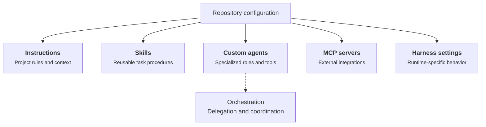

At work and on my personal projects, I spend a lot of time on GitHub. GitHub Copilot has been my usual coding assistant, and over time I've added instructions, skills, and custom agents to make it more useful in my repositories.

I've also tried Claude Code, Codex, and OpenCode. One thing I keep running into is the configuration. I open a repository in a different tool and find myself adapting files or recreating things I've already set up for GitHub Copilot. Sometimes the instructions carry over easily. Other times, an agent or workflow needs a different setup.

So I wanted to look at a fairly specific question: **if a repository is already configured for GitHub Copilot, what can I reuse with another coding harness?** This is about files and settings in the repository, not model providers, API keys, or subscriptions.

## What counts as agent configuration?

By configuration, I mean the files that tell a coding assistant about the project and how it should work. They serve different purposes:

- **Instructions** describe the repository, coding conventions, and rules for particular directories or files.
- **Skills** package repeatable tasks or workflows, usually as a `SKILL.md` file with optional supporting resources.
- **Custom agents** define specialized roles, often with their own prompts, tools, and execution settings.
- **MCP servers** connect the assistant to external tools and services. MCP is a shared protocol, but each client can store its server settings differently.
- **Permissions and hooks** control which actions are allowed and what happens around tool calls or other lifecycle events.
- **Orchestration** defines how agents delegate work, coordinate sessions, and hand results back. This is often the least portable part.

A GitHub Copilot-oriented repository might contain something like this:

```text
my-project/
├── AGENTS.md
├── .agents/
│   └── skills/
│       └── write-article/
│           └── SKILL.md
├── .github/
│   ├── copilot/
│   │   └── settings.json
│   ├── copilot-instructions.md
│   ├── instructions/
│   │   └── articles.instructions.md
│   └── agents/
│       └── reviewer.agent.md
├── .vscode/
│   └── mcp.json
└── src/
    └── AGENTS.md
```

The diagram summarizes how those pieces relate to one another:



Instructions and skills mainly describe *what an assistant should know or do*. Custom agents define *who handles a task*. MCP servers supply external capabilities. Harness settings control *how the runtime operates*, with details that vary between tools. Orchestration connects agents into a workflow, but its implementation can depend on the harness.

This is an **illustrative layout**, not a claim that every file exists in my website repository. Some files are shared conventions, while others are specific to a GitHub Copilot runtime. A different harness might understand the contents of a file but never look in that directory.

## Where each harness looks

Here is the cheat sheet I would have liked when I started trying other tools. It focuses on repository-level files, not user-level settings.

### Scope

I mainly use **GitHub Copilot CLI and the GitHub Copilot desktop app**. GitHub documents the desktop app as built on GitHub Copilot CLI. VS Code has a separate Agent Host architecture, so I do not assume that settings or features work identically across those environments. The comparison focuses on repository conventions and calls out runtime-specific differences.

### Configuration cheat sheet

| Asset | GitHub Copilot | OpenCode | Codex | Claude Code |
| --- | --- | --- | --- | --- |
| **Instructions** | `.github/copilot-instructions.md` (root-wide); `.github/instructions/**/*.instructions.md` (glob-scoped); root or nested `AGENTS.md` in supported surfaces | Root and nested `AGENTS.md` (V2: nested on file access); `opencode.json` `instructions` globs; legacy `CLAUDE.md` fallback | Root and nested `AGENTS.md`, plus `AGENTS.override.md` where applicable | Root and nested `CLAUDE.md`; `.claude/rules/`; nested `AGENTS.md` on file access (v2.1.277+, fallback by default) |
| **Skills** | `.agents/skills/<name>/SKILL.md`, `.github/skills/<name>/SKILL.md` | `.agents/skills/<name>/SKILL.md`, `.opencode/skills/<name>/SKILL.md` | `.agents/skills/<name>/SKILL.md` | `.claude/skills/<name>/SKILL.md` (no automatic `.agents/skills/` discovery documented) |
| **Custom agents** | `.github/agents/*.agent.md` | `.opencode/agents/*.md` or `opencode.json` / `opencode.jsonc` | `.codex/agents/<name>.toml` | `.claude/agents/*.md` (Markdown with YAML frontmatter) |
| **MCP servers** | `.github/mcp.json` (shared) or `.mcp.json` (repository root; GitHub Copilot CLI) | `opencode.json` | `.codex/config.toml` (trusted project) | `.mcp.json` (project root) |
| **Harness configuration** (permissions, hooks, tools) | `.github/copilot/settings.json` (shared repository settings); `.github/copilot/settings.local.json` (local overrides) | `opencode.json`, plugins | `.codex/config.toml` (trusted project) | `.claude/settings.json` (shared); `.claude/settings.local.json` (local override) |

### Nested instructions

All four harnesses support directory-specific `AGENTS.md` instructions, although they discover and load them differently. In OpenCode V2 and Claude Code, nested files are picked up when the agent works in the relevant directory. You do not need to move every `AGENTS.md` to the repository root.

### Claude Code's fallback rules

In Claude Code 2.1.277+, `AGENTS.md` is a fallback when no applicable `CLAUDE.md` exists. The `claude-md-and-agents-md` setting allows both formats to load. See the [Claude Code documentation](https://code.claude.com/docs/en/memory) for details.

### GitHub Copilot depends on the environment

GitHub Copilot CLI, VS Code, GitHub cloud agent, and code review do not support exactly the same instruction types. This article focuses on GitHub Copilot CLI and the desktop app, rather than treating every environment as equivalent. The [official support matrix](https://docs.github.com/en/copilot/reference/custom-instructions-support) documents the differences.

### MCP and harness-specific configuration

MCP is a shared protocol, but **how you configure an MCP server depends on the harness**. GitHub Copilot CLI and Claude Code recognize a project-level `.mcp.json`, and GitHub Copilot CLI also supports `.github/mcp.json`. OpenCode defines MCP servers in `opencode.json`, while Codex uses `.codex/config.toml`. The same MCP server may work across tools, but its configuration is not necessarily portable.

GitHub Copilot CLI does **not** read VS Code's `.vscode/mcp.json`; the [GitHub Copilot CLI MCP guide](https://docs.github.com/en/copilot/how-tos/copilot-cli/customize-copilot/add-mcp-servers) explains the difference.

The same applies to other harness settings: each tool uses its own configuration format. The cheat sheet above shows where those repository files live.

The table lists representative **repository-level** locations. It is based on documentation, not live compatibility tests.

## What needs to change when switching?

The first table shows **where each harness looks**. This one starts with a repository configured for **GitHub Copilot** and asks a more practical question: **what can I keep, and what needs adapting?** Reusing the text of an instruction is not the same as having another harness discover it automatically.

| GitHub Copilot | OpenCode | Codex | Claude Code |
| --- | --- | --- | --- |
| **Repository-wide instructions:** root `AGENTS.md` or `.github/copilot-instructions.md` | Reuse `AGENTS.md`; move or reference Copilot-specific instructions | Reuse `AGENTS.md`; move or reference Copilot-specific instructions | Reuse `AGENTS.md` on supported versions, subject to `CLAUDE.md` precedence; adapt Copilot-specific instructions |
| **Scoped instructions:** nested `AGENTS.md` or `.github/instructions/*.instructions.md` | Reuse nested `AGENTS.md` in V2; adapt Copilot-specific globs | Reuse nested `AGENTS.md`; adapt Copilot-specific globs | Reuse nested `AGENTS.md` on supported versions; adapt Copilot-specific globs and check `CLAUDE.md` precedence |
| **Skills:** `.agents/skills/` | Reuse the shared skill directory | Reuse the shared skill directory | Link or copy skills into `.claude/skills/` as needed |
| **Custom agents:** `.github/agents/*.agent.md` | Adapt agent metadata and configuration | Convert to TOML agent definitions | Adapt agent frontmatter and tool settings |
| **MCP servers** | Reuse server details; configure in `opencode.json` | Reuse server details; configure in `.codex/config.toml` | Reuse server details; configure in `.mcp.json` |
| **Delegation, permissions, and orchestration** | Rework and test workflows | Rework and test workflows | Rework and test workflows |

**The takeaway:** `AGENTS.md` and shared skills offer the easiest path to reuse. GitHub Copilot-specific instruction files usually need relocation or explicit inclusion. Custom agents and orchestration can carry over conceptually, but their configuration and behavior need review rather than a simple file copy.


## Instructions are getting easier to share

The most promising common denominator is [`AGENTS.md`](https://agents.md/), which can appear at more than one directory level. If a project puts general guidance there, different coding tools can potentially consume the same human-readable instructions.

For a repository used with multiple harnesses, shared architecture notes, commands, and conventions are good candidates for `AGENTS.md`.

The content itself is not tied to Copilot. The *path and loading rules* are.

There are still reasons to use GitHub Copilot-specific files: `.github/copilot-instructions.md` is GitHub Copilot's established repository instruction entry point, and `.github/instructions/*.instructions.md` can apply guidance to selected file patterns through `applyTo` frontmatter. Keep those when you need GitHub Copilot-specific behavior, but put broadly reusable instructions in `AGENTS.md` where practical. A path-scoped Copilot instruction is not automatically equivalent to an always-loaded Markdown file.

## Skills are moving in the same direction

The [Agent Skills specification](https://agentskills.io/) defines a reusable skill around a `SKILL.md` file and supporting resources. This is a much better starting point than maintaining parallel versions of the same coding checklist for every assistant.

Still, I would test two things separately: does the harness *find* the skill, and does it *use* it correctly for the task? Shared structure does not guarantee identical triggering, tools, or results.

My website's existing article guidance is a useful candidate for a future skill, but I would not call it a portable skill until it has actually been packaged and exercised in both tools.

## Custom agents are a different story

A custom agent is more than a prompt. It may specify tools, execution mode, permissions, delegation, and how work returns to the parent session.

My website's documented Product Owner to Orchestrator to Developer workflow makes this concrete. Its rules cover approval boundaries, branch isolation, and quality gates. Copying those instructions into an OpenCode agent file would preserve some intent, but would not recreate GitHub Copilot's execution model.

The realistic migration is to preserve the workflow contract, then implement and test the orchestration separately in each harness. A passing static contract validator is useful evidence about repository rules, **not** proof of equivalent live agent behavior.

## How I would approach a migration

I would avoid rewriting everything at once:

1. Audit the existing root and nested `AGENTS.md` files, keeping references to canonical `docs/specs/` documents rather than duplicating instructions.
2. Check which instructions OpenCode discovers without extra configuration.
3. Move genuinely reusable task guidance into Agent Skills where appropriate.
4. Translate one small custom agent, documenting differences in tools and permissions.
5. Run the same task in both harnesses and record what changed, including any manual intervention.

This order matters. If the simple instructions already work, there is no reason to build a configuration compiler just to copy Markdown files.

## Where portability still stops

The emerging answer is not that configuration is either portable or locked in. **Instructions and skills are increasingly reusable; agent execution remains harness-specific.**

For developers starting with GitHub Copilot, that suggests a practical rule: write shared knowledge in common formats first, and isolate runtime-specific behavior instead of letting it spread through the repository.

I have not yet run a controlled Copilot-versus-OpenCode migration of every asset in this repository, or equivalent checks for the other harnesses. The next step is to do that and replace the assessments above with observed results, including exact harness versions.

That experiment will tell us whether a configuration translation tool would actually save maintenance effort, or merely add another configuration format to maintain.

### Official references

- [AGENTS.md convention](https://agents.md/)
- [Agent Skills specification](https://agentskills.io/)
- [OpenCode rules](https://opencode.ai/docs/rules/) and [agents](https://opencode.ai/docs/agents/)
- [Codex configuration](https://learn.chatgpt.com/docs/config-file/config-basic) and [custom subagents](https://learn.chatgpt.com/docs/agent-configuration/subagents)
- [Claude Code instructions and AGENTS.md](https://code.claude.com/docs/en/memory), [skills](https://code.claude.com/docs/en/skills), [settings](https://code.claude.com/docs/en/settings), and [subagents](https://code.claude.com/docs/en/sub-agents)
- [Cursor documentation](https://cursor.com/docs)
- [Gemini CLI documentation](https://geminicli.com/docs/)
- [GitHub Copilot CLI repository MCP configuration](https://docs.github.com/en/copilot/how-tos/copilot-cli/customize-copilot/add-mcp-servers)\n- [Claude Code subagents](https://code.claude.com/docs/en/sub-agents)\n- [GitHub Copilot CLI configuration scopes](https://docs.github.com/en/copilot/reference/copilot-cli-reference/cli-config-dir-reference)
- [GitHub Copilot desktop app](https://docs.github.com/en/copilot/concepts/copilot-surfaces/github-copilot-app)
- [VS Code Agent Host architecture](https://code.visualstudio.com/blogs/2026/08/26/agent-host-architecture)
- [GitHub Copilot customization cheat sheet](https://docs.github.com/en/copilot/reference/customization-cheat-sheet)
- [GitHub Copilot instruction support by environment](https://docs.github.com/en/copilot/reference/custom-instructions-support)
