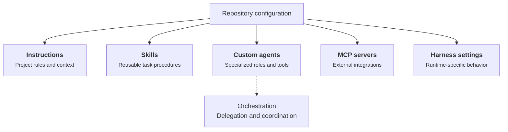

At work and on my personal projects, I spend a lot of time on GitHub. GitHub Copilot has been my usual coding assistant, and over time I've added instructions, skills, and custom agents to make it more useful in my repositories.

I've also tried Claude Code, Codex, and OpenCode. One thing I keep running into is the configuration. I open a repository in a different tool and find myself adapting files or recreating things I've already set up for GitHub Copilot. Sometimes the instructions carry over easily. Other times, an agent or workflow needs a different setup.

So I wanted to look at a fairly specific question: **if a repository is already configured for GitHub Copilot, what can I reuse with another coding harness?** This is about files and settings in the repository, not model providers, API keys, or subscriptions.

## What counts as agent configuration?

By configuration, I mean the files that tell a coding assistant about the project and how it should work. They serve different purposes:

- **Instructions** describe the repository, coding conventions, and rules for particular directories or files.
- **Skills** package repeatable tasks or workflows, usually as a `SKILL.md` file with optional supporting resources.
- **Custom agents** define specialized roles, often with their own prompts, tools, and execution settings.
- **MCP servers** connect the assistant to external tools and services. MCP is a shared protocol, but each client can store its server settings differently.
- **Permissions and hooks** control which actions are allowed and what happens around tool calls or other lifecycle events.
- **Orchestration** defines how agents delegate work, coordinate sessions, and hand results back. This is often the least portable part.

A GitHub Copilot-oriented repository might contain something like this:

```text
my-project/
├── AGENTS.md
├── .agents/
│   └── skills/
│       └── write-article/
│           └── SKILL.md
├── .github/
│   ├── copilot/
│   │   └── settings.json
│   ├── copilot-instructions.md
│   ├── instructions/
│   │   └── articles.instructions.md
│   └── agents/
│       └── reviewer.agent.md
├── .vscode/
│   └── mcp.json
└── src/
    └── AGENTS.md
```

The diagram summarizes how those pieces relate to one another:



Instructions and skills mainly describe *what an assistant should know or do*. Custom agents define *who handles a task*. MCP servers supply external capabilities. Harness settings control *how the runtime operates*, with details that vary between tools. Orchestration connects agents into a workflow, but its implementation can depend on the harness.

This is an **illustrative layout**, not a claim that every file exists in my website repository. Some files are shared conventions, while others are specific to a GitHub Copilot runtime. A different harness might understand the contents of a file but never look in that directory.

## Where each harness looks

Here is the cheat sheet I would have liked when I started trying other tools. It focuses on the main repository-level paths rather than every possible global setting.

**Scope:** I mainly use **GitHub Copilot CLI and the GitHub Copilot desktop app**. GitHub documents the desktop app as built on GitHub Copilot CLI. Separately, VS Code documents an **Agent Host** architecture for running agent sessions independently of the client UI; that does not mean the desktop app and CLI have identical settings or that every desktop session should be described as an Agent Host session. Some repository instructions and agent definitions overlap with VS Code, but support is not automatically identical. This table covers repository conventions and explicitly flags settings that depend on a particular GitHub Copilot runtime. GitHub.com, VS Code, Visual Studio, and JetBrains are not treated as interchangeable.

| Asset | GitHub Copilot | OpenCode | Codex | Claude Code |
| --- | --- | --- | --- | --- |
| **Instructions** | `.github/copilot-instructions.md` (root-wide); `.github/instructions/**/*.instructions.md` (glob-scoped); root or nested `AGENTS.md` in supported surfaces | `AGENTS.md` (project or ancestor); `opencode.json` `instructions` for extra files/globs; `CLAUDE.md` fallback | Root and nested `AGENTS.md`, plus `AGENTS.override.md` where applicable | Root and nested `CLAUDE.md`; `.claude/rules/` for modular rules |
| **Skills** | `.agents/skills/<name>/SKILL.md`, `.github/skills/<name>/SKILL.md` | `.agents/skills/<name>/SKILL.md`, `.opencode/skills/<name>/SKILL.md` | `.agents/skills/<name>/SKILL.md` | `.claude/skills/<name>/SKILL.md` |
| **Custom agents** | `.github/agents/*.agent.md` | `.opencode/agents/*.md` or `opencode.json` | Agent roles in Codex configuration | `.claude/agents/*.md` |
| **MCP servers** | `.vscode/mcp.json` for VS Code; other Copilot surfaces vary | `opencode.json` | `.codex/config.toml` or user settings | `.mcp.json` |
| **Harness configuration** (permissions, hooks, tools) | `.github/copilot/settings.json` (shared repository settings); `.github/copilot/settings.local.json` (local overrides); `~/.copilot/settings.json` (user settings) | `opencode.json`, plugins | `config.toml` | `.claude/settings.json` |

**Nested instruction files are real, but not identical across tools.** GitHub documents multiple `AGENTS.md` files at different directory levels, with the nearest applicable file taking precedence. Codex collects guidance along the path from repository root to the working directory, so deeper instructions can refine earlier ones. Claude Code supports nested `CLAUDE.md` files. OpenCode supports ancestor discovery, but you should not assume it eagerly loads every descendant `AGENTS.md` when working from the repository root. Its explicit `instructions` globs can cover additional files. These are different discovery semantics, not one universal scoping algorithm.

GitHub Copilot also differs by surface: VS Code, GitHub Copilot CLI, GitHub cloud agent, and code review do not support precisely the same instruction types. Check the [official support matrix](https://docs.github.com/en/copilot/reference/custom-instructions-support) before treating a GitHub Copilot file as universally recognized.

For GitHub Copilot CLI, repository settings are deliberately limited to supported keys; unsupported user-level settings are ignored if placed in `.github/copilot/settings.json`. The [configuration reference](https://docs.github.com/en/copilot/reference/copilot-cli-reference/cli-config-dir-reference) documents the supported keys and precedence. The separate `~/.copilot/config.json` is automatically managed state, **not** the recommended shared repository settings file.

This table lists **representative repository locations**, not every user-level setting or legacy path. It is a documentation-based cheat sheet, not a cross-harness runtime test.

## What needs to change when switching?

| GitHub Copilot asset | OpenCode | Codex | Claude Code |
| --- | --- | --- | --- |
| Root `AGENTS.md` | Read as-is | Read as-is | Do not assume native discovery; bridge via `CLAUDE.md` |
| `.github/copilot-instructions.md` | Explicitly reference or adapt | Explicitly reference or adapt | Explicitly reference or adapt |
| `.github/instructions/*.instructions.md` | Translate scoping | Translate scoping | Translate scoping |
| Shared `.agents/skills/` | Shared skill location | Shared skill location | Check skill location / link or copy as needed |
| GitHub Copilot `.agent.md` profiles | Translate | Translate | Translate |
| MCP server definitions | Reuse server details, rewrite client config | Reuse server details, rewrite client config | Reuse server details, rewrite client config |
| Delegation, permissions, session orchestration | Redesign and test | Redesign and test | Redesign and test |

Unlike the first table, which is a file-location reference, this one focuses on **migration effort**. The biggest distinction is between **content reuse** and **automatic loading**. A Markdown instruction can be perfectly reusable even if the target tool never discovers its original file path. A custom agent can reuse the same prompt while requiring a different execution contract.

For more on Codex's agent configuration, see the [official Codex documentation](https://developers.openai.com/codex/).

## How this applies to my website

My website already contains a root `AGENTS.md`, plus nested guidance and GitHub Copilot-specific instruction files. Its root file points back to `.github/copilot-instructions.md` and `docs/specs/`. This is a reasonable way to avoid repeating project knowledge, but it also means that a harness must follow those references for the full guidance to take effect.

The repository's Product Owner, Orchestrator, and Developer workflow is a tougher case. Its approval, branch, and quality-gate rules are meaningful regardless of harness, but the delegation mechanics are not portable merely because the Markdown is.

## Instructions are getting easier to share

The most promising common denominator is [`AGENTS.md`](https://agents.md/), which can appear at more than one directory level. If a project puts general guidance there, different coding tools can potentially consume the same human-readable instructions.

My repository already has a root `AGENTS.md` that points to GitHub Copilot instructions and canonical specs, so some guidance is shared without duplication. Important context still lives in `.github/copilot-instructions.md`: project architecture, commands, coding conventions, and links to the actual specs under `docs/specs/`.

The content itself is not tied to Copilot. The *path and loading rules* are.

A sensible cleanup would be to keep shared guidance in `AGENTS.md`, leave genuinely GitHub Copilot-specific instructions in `.github/`, and verify how each harness handles scoped instructions. A path-scoped Copilot instruction is not automatically equivalent to an always-loaded Markdown file.

## Skills are moving in the same direction

The [Agent Skills specification](https://agentskills.io/) defines a reusable skill around a `SKILL.md` file and supporting resources. This is a much better starting point than maintaining parallel versions of the same coding checklist for every assistant.

Still, I would test two things separately: does the harness *find* the skill, and does it *use* it correctly for the task? Shared structure does not guarantee identical triggering, tools, or results.

My website's existing article guidance is a useful candidate for a future skill, but I would not call it a portable skill until it has actually been packaged and exercised in both tools.

## Custom agents are a different story

A custom agent is more than a prompt. It may specify tools, execution mode, permissions, delegation, and how work returns to the parent session.

My website's documented Product Owner to Orchestrator to Developer workflow makes this concrete. Its rules cover approval boundaries, branch isolation, and quality gates. Copying those instructions into an OpenCode agent file would preserve some intent, but would not recreate GitHub Copilot's execution model.

The realistic migration is to preserve the workflow contract, then implement and test the orchestration separately in each harness. A passing static contract validator is useful evidence about repository rules, **not** proof of equivalent live agent behavior.

## How I would approach a migration

I would avoid rewriting everything at once:

1. Audit the existing root and nested `AGENTS.md` files, keeping references to canonical `docs/specs/` documents rather than duplicating instructions.
2. Check which instructions OpenCode discovers without extra configuration.
3. Move genuinely reusable task guidance into Agent Skills where appropriate.
4. Translate one small custom agent, documenting differences in tools and permissions.
5. Run the same task in both harnesses and record what changed, including any manual intervention.

This order matters. If the simple instructions already work, there is no reason to build a configuration compiler just to copy Markdown files.

## Where portability still stops

The emerging answer is not that configuration is either portable or locked in. **Instructions and skills are increasingly reusable; agent execution remains harness-specific.**

For developers starting with GitHub Copilot, that suggests a practical rule: write shared knowledge in common formats first, and isolate runtime-specific behavior instead of letting it spread through the repository.

I have not yet run a controlled Copilot-versus-OpenCode migration of every asset in this repository, or equivalent checks for the other harnesses. The next step is to do that and replace the assessments above with observed results, including exact harness versions.

That experiment will tell us whether a configuration translation tool would actually save maintenance effort, or merely add another configuration format to maintain.

### Official references

- [AGENTS.md convention](https://agents.md/)
- [Agent Skills specification](https://agentskills.io/)
- [OpenCode rules](https://opencode.ai/docs/rules/) and [agents](https://opencode.ai/docs/agents/)
- [Codex documentation](https://developers.openai.com/codex/)
- [Claude Code memory](https://code.claude.com/docs/en/memory) and [subagents](https://code.claude.com/docs/en/sub-agents)
- [Cursor documentation](https://cursor.com/docs)
- [Gemini CLI documentation](https://geminicli.com/docs/)
- [GitHub Copilot CLI configuration scopes](https://docs.github.com/en/copilot/reference/copilot-cli-reference/cli-config-dir-reference)
- [GitHub Copilot desktop app](https://docs.github.com/en/copilot/concepts/copilot-surfaces/github-copilot-app)
- [VS Code Agent Host architecture](https://code.visualstudio.com/blogs/2026/08/26/agent-host-architecture)
- [GitHub Copilot customization cheat sheet](https://docs.github.com/en/copilot/reference/customization-cheat-sheet)
- [GitHub Copilot instruction support by environment](https://docs.github.com/en/copilot/reference/custom-instructions-support)
