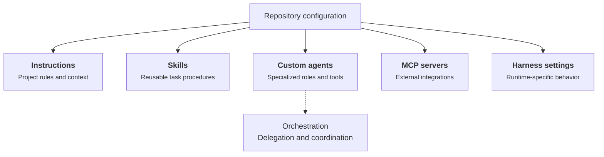

At work and on my personal projects, I spend a lot of time on GitHub. GitHub Copilot has been my usual coding assistant, and over time I've added instructions, skills, and custom agents to make it more useful in my repositories.

I've also tried Claude Code, Codex, and OpenCode. One thing I keep running into is the configuration. I open a repository in a different tool and find myself adapting files or recreating things I've already set up for GitHub Copilot. Sometimes the instructions carry over easily. Other times, an agent or workflow needs a different setup.

So I wanted to look at a fairly specific question: **if a repository is already configured for GitHub Copilot, what can I reuse with another coding tool?** By *harness*, I mean the tool that runs the coding agent, provides tools, and manages its workflow. This is about files and settings in the repository, not model providers, API keys, or subscriptions. The comparison reflects documented behavior as of October 2026, not a hands-on compatibility benchmark.

## What counts as agent configuration?

By configuration, I mean the files that tell a coding assistant about the project and how it should work. They serve different purposes:

- **Instructions** describe the repository, coding conventions, and rules for particular directories or files.
- **Skills** package repeatable tasks or workflows, usually as a `SKILL.md` file with optional supporting resources.
- **Custom agents** define specialized roles, often with their own prompts, tools, and execution settings.
- **MCP servers** connect the assistant to external tools and services. MCP is a shared protocol, but each client can store its server settings differently.
- **Permissions and hooks** control which actions are allowed and what happens around tool calls or other lifecycle events.
- **Orchestration** defines how agents delegate work, coordinate sessions, and hand results back. This is often the least portable part.

A GitHub Copilot-oriented repository might contain something like this:

```text
my-project/
├── AGENTS.md
├── .agents/
│   └── skills/
│       └── write-article/
│           └── SKILL.md
├── .github/
│   ├── copilot/
│   │   └── settings.json
│   ├── copilot-instructions.md
│   ├── instructions/
│   │   └── articles.instructions.md
│   └── agents/
│       └── reviewer.agent.md
├── .vscode/
│   └── mcp.json
└── src/
    └── AGENTS.md
```

The diagram summarizes how those pieces relate to one another:



Instructions and skills mainly describe *what an assistant should know or do*. Custom agents define *who handles a task*. MCP servers supply external capabilities. Harness settings control *how the runtime operates*, with details that vary between tools. Orchestration connects agents into a workflow, but its implementation can depend on the harness.

This is an **illustrative layout**, not a claim that every file exists in my website repository. Some files are shared conventions, while others are specific to a GitHub Copilot runtime. A different harness might understand the contents of a file but never look in that directory.

## Where each harness looks

Here is the cheat sheet I would have liked when I started trying other tools. It focuses on repository-level files, not user-level settings.

### Scope

For GitHub Copilot, the main scope is **Copilot CLI and the desktop app**, not every Copilot integration. Other surfaces, including VS Code and GitHub.com, have their own instruction support. A repository that works in the CLI may need different files or settings elsewhere; check the [official support matrix](https://docs.github.com/en/copilot/reference/custom-instructions-support) before assuming automatic discovery. User-level settings also exist but are outside this comparison.

### Configuration cheat sheet

| Asset | GitHub Copilot | OpenCode | Codex | Claude Code |
| --- | --- | --- | --- | --- |
| **Instructions** | `.github/copilot-instructions.md` (root-wide); `.github/instructions/**/*.instructions.md` (glob-scoped); root or nested `AGENTS.md` in supported surfaces | Root and nested `AGENTS.md` (V2: nested on file access); `opencode.json` `instructions` globs; legacy `CLAUDE.md` fallback | Root and nested `AGENTS.md`, with `AGENTS.override.md` taking precedence over `AGENTS.md` in the same directory | Root and nested `CLAUDE.md`; `.claude/rules/`; nested `AGENTS.md` on file access where supported (fallback when no applicable `CLAUDE.md`) |
| **Skills** | `.agents/skills/<name>/SKILL.md`, `.github/skills/<name>/SKILL.md` | `.agents/skills/<name>/SKILL.md`, `.opencode/skills/<name>/SKILL.md` | `.agents/skills/<name>/SKILL.md` | `.claude/skills/<name>/SKILL.md` (no automatic `.agents/skills/` discovery documented) |
| **Custom agents** | `.github/agents/*.agent.md` | `.opencode/agents/*.md` or `opencode.json` / `opencode.jsonc` | `.codex/agents/<name>.toml` | `.claude/agents/*.md` (Markdown with YAML frontmatter) |
| **MCP servers** | `.github/mcp.json` (shared) or `.mcp.json` (repository root; GitHub Copilot CLI) | `opencode.json` | `.codex/config.toml` (trusted project) | `.mcp.json` (project root) |
| **Harness configuration** (permissions, hooks, tools) | `.github/copilot/settings.json` (shared repository settings); `.github/copilot/settings.local.json` (local overrides) | `opencode.json`, plugins | `.codex/config.toml` (trusted project) | `.claude/settings.json` (shared); `.claude/settings.local.json` (local override) |

### Nested instructions

All four harnesses support directory-specific `AGENTS.md` instructions, although they discover and load them differently. In OpenCode V2 and Claude Code, nested files are picked up when the agent works in the relevant directory. You do not need to move every `AGENTS.md` to the repository root.

### Claude Code's fallback rules

In Claude Code versions that support `AGENTS.md`, it can serve as a fallback when no applicable `CLAUDE.md` exists. The `claude-md-and-agents-md` setting allows both formats to load; check your installed version against the documentation. See the [Claude Code documentation](https://code.claude.com/docs/en/memory) for details.

### GitHub Copilot depends on the environment

Copilot CLI and desktop are the baseline here. If you also work in VS Code, GitHub.com, or another Copilot surface, check the [official support matrix](https://docs.github.com/en/copilot/reference/custom-instructions-support): the same repository instructions are not necessarily discovered in every environment.

### MCP and harness-specific configuration

MCP is a shared protocol, but **how you configure an MCP server depends on the harness**. GitHub Copilot CLI and Claude Code recognize a project-level `.mcp.json`, and GitHub Copilot CLI also supports `.github/mcp.json`. OpenCode defines MCP servers in `opencode.json`, while Codex uses `.codex/config.toml`. The same MCP server may work across tools, but its configuration is not necessarily portable.

GitHub Copilot CLI does **not** read VS Code's `.vscode/mcp.json`; the [GitHub Copilot CLI MCP guide](https://docs.github.com/en/copilot/how-tos/copilot-cli/customize-copilot/add-mcp-servers) explains the difference.

The same applies to other harness settings: each tool uses its own configuration format. The cheat sheet above shows where those repository files live.

The table lists representative **repository-level** locations. It is based on documentation, not live compatibility tests.

## What needs to change when switching?

The first table shows **where each harness looks**. This one starts with a repository configured for **GitHub Copilot** and asks a more practical question: **what can I keep, and what needs adapting?** Reusing the text of an instruction is not the same as having another harness discover it automatically.

| GitHub Copilot | OpenCode | Codex | Claude Code |
| --- | --- | --- | --- |
| **Repository-wide instructions:** root `AGENTS.md` or `.github/copilot-instructions.md` | Reuse `AGENTS.md`; move or reference Copilot-specific instructions | Reuse `AGENTS.md`; move or reference Copilot-specific instructions | Reuse `AGENTS.md` on supported versions, subject to `CLAUDE.md` precedence; adapt Copilot-specific instructions |
| **Scoped instructions:** nested `AGENTS.md` or `.github/instructions/*.instructions.md` | Reuse nested `AGENTS.md` in V2; adapt Copilot-specific globs | Reuse nested `AGENTS.md`; adapt Copilot-specific globs | Reuse nested `AGENTS.md` on supported versions; adapt Copilot-specific globs and check `CLAUDE.md` precedence |
| **Skills:** `.agents/skills/` | Reuse the shared skill directory | Reuse the shared skill directory | Link or copy skills into `.claude/skills/` as needed |
| **Custom agents:** `.github/agents/*.agent.md` | Adapt agent metadata and configuration | Convert to TOML agent definitions | Adapt agent frontmatter and tool settings |
| **MCP servers** | Reuse server details; configure in `opencode.json` | Reuse server details; configure in `.codex/config.toml` | Reuse server details; configure in `.mcp.json` |
| **Delegation, permissions, and orchestration** | Rework and test workflows | Rework and test workflows | Rework and test workflows |

**The takeaway:** `AGENTS.md` and shared skills offer the easiest path to reuse. GitHub Copilot-specific instruction files usually need relocation or explicit inclusion. Custom agents and orchestration can carry over conceptually, but their configuration and behavior need review rather than a simple file copy.


## How I would approach a migration

I would start with the most reusable pieces and move toward the harness-specific ones: consolidate instructions in `AGENTS.md`, share skills through `.agents/skills/`, then migrate custom agents and harness-specific MCP settings. Finally, I would test representative tasks in each harness. The sections below explain where the differences matter.

## Instructions are getting easier to share

For repository-wide guidance, **prefer [`AGENTS.md`](https://agents.md/)**. All four harnesses covered here recognize it in their documented configurations, so architecture notes, development commands, and coding conventions can live in one shared file. If you only need those general instructions in GitHub Copilot CLI, `.github/copilot-instructions.md` offers little portability benefit over `AGENTS.md`. It can still matter for other GitHub Copilot environments (for example, GitHub.com, VS Code, or JetBrains), where instruction-file support differs.

**Scoped instructions are the important exception.** Nested `AGENTS.md` files organize guidance by directory, but GitHub Copilot's `.github/instructions/*.instructions.md` supports `applyTo` glob patterns. That lets you target a single file, such as `src/App.tsx`, or files matching `**/*.tsx` across multiple directories. A nested `AGENTS.md` does not provide the same file-pattern targeting.

**My rule of thumb:** Prefer `AGENTS.md` for both root and nested directory instructions. Use GitHub Copilot-specific files when you need file-pattern targeting with `applyTo`, or intentionally want Copilot-only behavior. Avoid duplicating rules.

**Check which GitHub Copilot environment you use.** The [official custom-instruction support matrix](https://docs.github.com/en/copilot/reference/custom-instructions-support) lists `AGENTS.md` support for GitHub Copilot CLI, VS Code Copilot Chat, cloud agent, and code review, but not for GitHub.com Copilot Chat or JetBrains Copilot Chat. This article focuses on GitHub Copilot CLI and desktop; do not assume every integration recognizes the same files.


## Share skills through `.agents/skills/`

For skills, there is a particularly easy portability win: **put reusable skills in `.agents/skills/<name>/SKILL.md`** rather than keeping them only under GitHub Copilot's `.github/skills/`. GitHub Copilot, OpenCode, and Codex all document discovery of the shared `.agents/skills/` location, so those three harnesses can find the same skill without maintaining three copies.

Claude Code discovers project skills under `.claude/skills/` instead, and does not document a setting to replace that default path with `.agents/skills/`. Fortunately, [Claude Code supports symlinked skill directories](https://code.claude.com/docs/en/skills). Keep `.agents/skills/` as the source of truth and symlink each skill into `.claude/skills/` rather than maintaining copies. For example, from the repository root: `mkdir -p .claude/skills && ln -s ../../.agents/skills/code-review .claude/skills/code-review` (assuming the `code-review` skill exists).

The [Agent Skills specification](https://agentskills.io/) provides a common `SKILL.md` format. **Sharing the file is not the same as guaranteeing identical behavior**: each harness may decide differently when to discover, load, and run a skill. Test skill discovery in every harness, both by asking for the skill explicitly and by trying a task that should trigger it naturally. Then check whether the resulting behavior matches your expectations. A shared directory is a portability win, not a substitute for testing.


## Custom agents need an active migration

Custom agents are harder to move than instructions or skills. Their definitions combine a role and instructions with harness-specific tools, permissions, delegation, and execution behavior. There is no common custom-agent configuration format supported across GitHub Copilot, OpenCode, Codex, and Claude Code.

**Reuse the intent, but migrate the implementation.** Translate each agent definition into the target harness's format, then test representative tasks, tool access, approval boundaries, delegation, and results. Copying the prompt alone does not reproduce the workflow.

For now, custom agents require deliberate, harness-by-harness migration and evaluation.

To validate a migration, I would run the same representative tasks in each tool and compare the results, tool access, permissions, and delegation—not just whether the agent produces a plausible answer.

## What's next?

I would like to test real migrations between GitHub Copilot, OpenCode, Codex, and Claude Code and compare their behavior on the same tasks. One question worth exploring is whether an **agent-specific translation tool** could reduce the effort of maintaining custom agents across tools without obscuring differences in tools, permissions, and delegation. I have not yet run controlled, versioned comparisons, so this article describes documented support rather than verified behavioral equivalence.

## Conclusion: Where portability still stops

Portability is not all or nothing. **Instructions and skills are increasingly reusable; custom-agent execution remains harness-specific.** My takeaway is simple: keep shared knowledge in existing formats first, and isolate behavior that depends on a particular tool.

### Official references

For the main configuration documentation of each harness:

1. [GitHub Copilot customization](https://docs.github.com/en/copilot/reference/customization-cheat-sheet)
2. [OpenCode configuration](https://opencode.ai/docs/config/)
3. [Codex configuration](https://developers.openai.com/codex/config-basic)
4. [Claude Code settings](https://code.claude.com/docs/en/settings)
